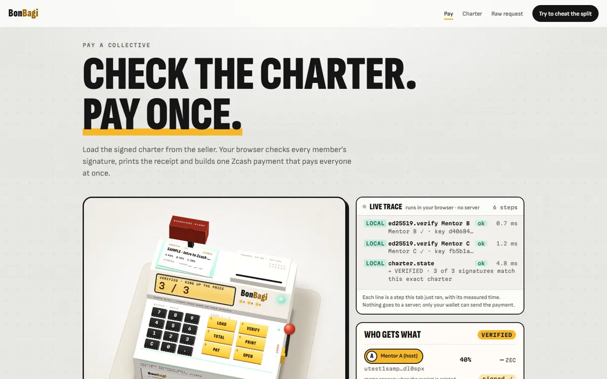
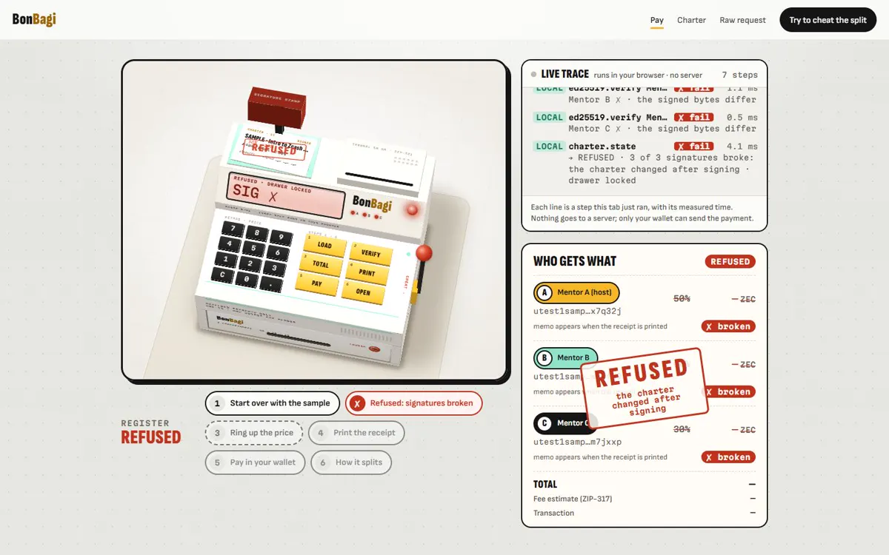
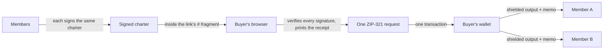

# BonBagi

[](https://github.com/BonBagi/frontend/actions/workflows/ci.yml)  

**One payment. Every share. Nobody's business.**

BonBagi lets a small collective (two mentors running a class, a band, a co-op) get paid with **one Zcash shielded payment that splits to every member in a single transaction**. No treasurer collects the money, no custodian holds it, and no server learns who was paid how much. Built for ZECATHON 2026, track **Shielded Payments**, October 2026.

*Bon* is Indonesian for a receipt; *bagi* means to split.

- **Live demo:** https://bonbagi.vercel.app (no install, no account, no wallet needed to try it)
- **Video (2 min):** _(link added at submission)_



## Try it in 60 seconds

1. Open **https://bonbagi.vercel.app/pay.html** and press **Try a sample charter**. Three throw-away keys sign a testnet charter in your browser, and the page shows "Verified in your browser, signed by all 3 members".
2. Press **Print the receipt**: one card with the total, each member's share and the ZIP-321 request (QR, copy, open in wallet), plus the itemised paper receipt.
3. Now cheat. In the JSON box, change one share (`"bps": 4000` → `5000` and `3000` → `2000`, still 100%) and press **Check charter**. Every signature breaks and the page refuses to build a payment.



## What is real and what is a mock

| Real | Mock |
|---|---|
| Ed25519 charter signing and verification, the deterministic zatoshi split, the ZIP-321 request, the QR and the memos are all computed in your browser by [@bonbagi/core](https://github.com/BonBagi/core) (39 unit tests). | The **sample charter** on the pay page: its testnet addresses are made up and fail the wallet checksum, so the sample cannot move funds. |
| A real payment on **Zcash testnet** (Hans, 18 Oct): one ZIP-321 request built by `buildPaymentRequest`, one transaction (`485623f7…f520`, block 4514615), three shielded outputs of 0.0012 / 0.0009 / 0.0009 TAZ, each memo read by the receiving wallet, fee 0.0002 = our ZIP-317 estimate. | The numbers in the landing page animation (0.01 ZEC, 40/30/30) are illustration only. |

## How it maps to the judging criteria

| Criterion | What BonBagi does |
|---|---|
| **Privacy** | Every share is a shielded output; transparent addresses are rejected. The charter travels in the link's `#` fragment, which browsers never send to a server. The pay, charter and raw-request pages run under a Content-Security-Policy with `connect-src 'none'`. The claims are narrow and the limits are written down in [docs/THREAT-MODEL.md](docs/THREAT-MODEL.md). |
| **Usefulness** | Anyone who sells together (mentors, bands, co-ops, freelancers) can stop trusting one person to pay the others back. The buyer's experience is a normal Zcash payment: one link or QR, one confirmation. |
| **Execution** | Live static site, no backend. Signature checks, split math and the request are deterministic and unit-tested. Real testnet run done (tx `485623f7…f520`); the mainnet transaction ID is added here once it is made. |
| **Originality** | A signed split agreement plus one multi-recipient shielded payment, with no contract and no custodian. The buyer can verify the split before paying, and the public sees nothing. |

## How it works



1. **Members sign a charter.** Each member creates an Ed25519 signing key in their browser. The group drafts one charter: every member's shielded address and share. Every member signs the same canonical bytes. Changing anything afterwards breaks all signatures.
2. **The seller shares a pay link.** The signed charter travels inside the link's `#` fragment.
3. **The buyer's browser verifies.** The pay page checks every signature locally, then shows the receipt: each recipient, their share, the exact amount in ZEC, the total and an estimated network fee.
4. **One payment.** The page builds a single [ZIP-321](https://zips.z.cash/zip-0321) multi-recipient request (QR, copy, or open in wallet). The buyer's wallet sends one transaction with one shielded output per member, each with an encrypted memo (order ID + charter fingerprint) so members can reconcile.

The site is fully static and client-side. There is no backend, database or account.

## What stays private

| Party | Sees | Does not see |
|---|---|---|
| Public chain observer | A shielded transaction happened; its fee and number of shielded actions (≈ members + change) | Who paid, who was paid, amounts, memos |
| Buyer | Every member's label, address, share and amount (by design, so they can check before paying) | Members' balances or other payments |
| Each member | Their own amount and memo; the charter they signed | The buyer's identity, other buyers' payments |
| Page host | Requests for static files (IP, time) | The charter, addresses, prices or payment requests |

The claim is deliberately narrow: BonBagi adds no privacy of its own; it avoids removing the privacy Zcash already provides.

Enforced in code, not just promised:
- Strict Content-Security-Policy on the pay, charter and raw-request pages with `connect-src 'none'`: they cannot make network requests or load third-party scripts, fonts or images. The landing page may only fetch its own 3D model files from this site.
- No cookies, no `localStorage`, no logging of addresses or payment requests.
- Transparent addresses are rejected; every share is shielded.
- Deterministic zatoshi split (largest-remainder, ties to the first member) and a minimum per member to avoid dust.
- The payment QR stays under frost until the buyer taps it, so a glance over the shoulder shows nothing.

## Limits, and what breaks first

- **The number of members is roughly public**: a payment to N members has about N+1 shielded actions. Next step: pad with dummy outputs.
- **The buyer sees the member list and amounts.** That is the point (they check before paying), and it is why every member must sign.
- **Signatures prove agreement, not identity.** Compare the charter fingerprint with the one the seller published.
- **Wallet support breaks first.** The buyer needs a wallet that shows every recipient of a multi-recipient request (tested target: Zingo PC 2.0.26; backup Zkool). Some mobile wallets show only the first recipient, and the receipt warns about this.
- **QR density**: a request for 3 members is about 1,000 characters. Past roughly 5 members, use *Copy request* or *Open in wallet* instead of the QR (the page offers all three).
- The price in a pay link is not signed; it only pre-fills the form. Full list: [docs/THREAT-MODEL.md](docs/THREAT-MODEL.md).

## Pages

- **Landing** (`/`): what BonBagi is, in one scroll.
- **Pay** (`/pay.html`): load a charter (pay link, paste or file) → verify → receipt → request.
- **Charter** (`/charter.html`): create keys, draft, sign one by one, check, then create the pay link.
- **Raw request** (`/gate.html`): build a plain request for two or three recipients to test whether a wallet supports multi-recipient payments.

## Built during ZECATHON

All code was written during the build window: the repository starts on 17 Oct 2026 and the commit history shows each step (core library and tests → charter page → pay page → privacy hardening → design rounds → testnet run → two-member demo).

## Develop

```bash
npm ci
npm test         # unit tests (vitest)
npm run dev      # http://localhost:5173
npm run build    # static site in dist/
```

Payment logic lives in **[@bonbagi/core](https://github.com/BonBagi/core)** (signed charter, split, ZIP-321, memos, pay links; pure and tested). This app installs it from the `v0.1.0` tag and runs the same 39 tests against the installed package (`test/`).

Pages: `index.html` + `src/landing/` (landing), `pay.html` + `src/pay-page.ts`, `charter.html` + `src/charter-page.ts`, `gate.html` + `src/gate.ts`. Dependencies: `@noble/ed25519` (Ed25519), `qrcode-generator` and `three` (landing only), all bundled; nothing is loaded from a CDN. Fonts are bundled too (SIL Open Font License, see `src/fonts/LICENSE.txt`).

## Repositories

| Repo | What |
|---|---|
| **frontend** (this) | The live site: landing, pay, charter and raw-request pages |
| [core](https://github.com/BonBagi/core) | `@bonbagi/core`: charter, split, ZIP-321, memos, pay links (v0.1.0) |
| [watcher](https://github.com/BonBagi/watcher) | Member-run verifier (Rust CLI, v0.1.0): confirms your own share with a viewing key and signs a receipt; byte-for-byte the same rules as core; no server |

Backlog with shared IDs: [docs/BACKLOG.md](docs/BACKLOG.md). Security: [SECURITY.md](SECURITY.md). Contributing: [CONTRIBUTING.md](CONTRIBUTING.md).

## Team

Dex Bennett ([@Stylenecy](https://github.com/Stylenecy), owner: product, charter and pay pages, design) · Hans ([@Shenhan01-sys](https://github.com/Shenhan01-sys): split and memo review, privacy audit, testnet run) · Dave ([@agadape](https://github.com/agadape)).

## License

MIT
